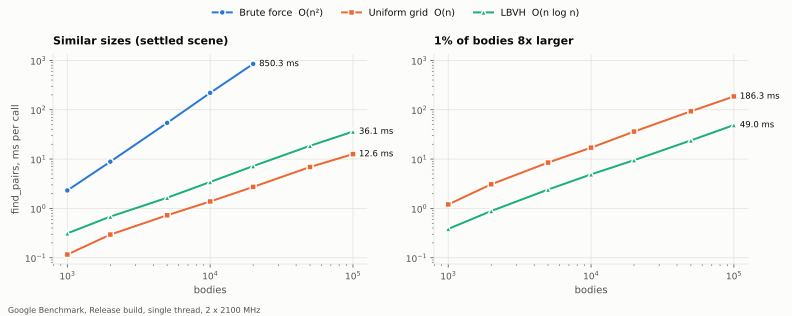

# Idem

[](https://github.com/DanyilYedelkin/Idem/actions/workflows/ci.yml)

A headless, fixed-timestep rigid-body simulation core built around one guarantee:
**the same inputs produce the same bits**, on GCC, Clang and MSVC, at any
optimisation level, with any of its three broad-phase algorithms.

Every run can be recorded as its initial conditions plus the external inputs of
each tick. A replay re-simulates from that alone and compares a hash of the full
state after every tick, so it either confirms the run or names the exact tick
where it went wrong.

That property is what after-action review of a training exercise, bug
reproduction from a field report, and lockstep networking all depend on.

*Idem* is Latin for "the same".

```text
$ idem record --bodies 20000 --ticks 600 --seed 1337 --out run.idem
recorded 600 ticks of 20000 bodies with grid -> run.idem
  12.675 ms/tick, 36122 contacts/tick
  final hash 0x8d142a176ee9c5e2

$ idem replay run.idem --broadphase bvh
OK: 600 ticks verified with bvh
  19.219 ms/tick, 36122 contacts/tick
  final hash 0x8d142a176ee9c5e2
```

Ten seconds of simulated time for 20 000 bodies fits in a 26 KB file.

## Building

Requires CMake 3.25+ and a C++23 compiler: GCC 14, Clang 19 or Visual Studio 2022
17.10+. Catch2 and Google Benchmark are fetched automatically.

```sh
# Linux / macOS
cmake --preset release
cmake --build --preset release
ctest --preset release

# Windows (Visual Studio 2022)
cmake --preset vs2022
cmake --build --preset vs2022-release
ctest --preset vs2022-release
```

There is also a `sanitize` preset (Debug + ASan + UBSan) and a `debug` preset.

## Command line

```text
idem record [--bodies N] [--ticks N] [--seed N] [--broadphase brute|grid|bvh] [--out FILE]
idem replay FILE [--broadphase brute|grid|bvh]
idem info FILE
idem diff FILE_A FILE_B
```

`diff` compares two recordings of the same scenario, typically from two builds,
and reports the first tick at which their inputs or states differ. CI uses it to
compare the GCC, Clang and MSVC builds.

## How a tick works

```text
apply commands -> integrate -> walls -> AABBs -> broad-phase -> sort pairs -> contact solve -> tick++
```

- **Fixed timestep.** `dt` is part of the recorded parameters; the simulation has
  no notion of wall-clock time.
- **Semi-implicit Euler** integration, spheres with mass proportional to r³,
  restitution and positional correction.
- **Sequential impulse solver.** Contacts are resolved one after another, each
  seeing the corrections of the previous ones. This converges faster than a
  Jacobi-style solver but makes the result depend on pair order, which is why
  pairs are sorted before solving.
- **Structure-of-arrays** body storage (`std::vector<Vec3>` per attribute).
- **Commands** (`body`, `impulse`) are the only external input. In the CLI they
  come from a seeded `InputScript` standing in for operators or AI; during replay
  they come from the file.

```text
include/idem/
  math.hpp            Vec3, Aabb, floating-point environment checks
  rng.hpp             SplitMix64, xoshiro256** and portable float/int mappings
  scene.hpp           scene generation from a seed
  simulation.hpp      the step pipeline
  broadphase/         BroadPhase concept, brute force, uniform grid, LBVH
  state_hash.hpp      bit-exact state hashing
  recording.hpp       binary recording format
  replay.hpp          record() and replay()
apps/idem/            command-line tool
tests/                Catch2 tests
bench/                Google Benchmark suite
tools/                benchmark plotting
```

## Broad-phase

All three implementations satisfy the same concept and are interchangeable at
run time through a `std::variant`. The concept's contract is deliberately weak
(report every overlapping pair once, in any order) so each one is free to traverse
in whatever order suits its data structure.

| | Build | Query | Notes |
|---|---|---|---|
| **Brute force** | none | O(n²) | Reference implementation the others are tested against. |
| **Uniform grid** | O(n + cells), counting sort | O(n · k) | Dense grid sized to the largest box. Each cell is checked against itself and half of its neighbourhood. After the counting sort, cells x-1..x+1 of a row are contiguous, so a neighbourhood is 5 contiguous ranges rather than 13 cell lookups. |
| **LBVH** | O(n) after a radix sort | O(n log n) | Karras (2012): Morton codes, 3-pass LSD radix sort, each internal node built independently from the sorted keys, bounds fitted bottom-up. Self-collision only descends into subtrees containing leaves to the right of the query. |



Similar-sized bodies (a scene after two seconds of simulation, including the
pile-up on the floor):

| bodies | Brute force | Uniform grid | LBVH |
|---:|---:|---:|---:|
| 1,000 | 2.32 ms | 0.12 ms | 0.31 ms |
| 10,000 | 219.74 ms | 1.38 ms | 3.44 ms |
| 20,000 | 850.29 ms | 2.73 ms | 7.22 ms |
| 50,000 | — | 6.91 ms | 18.61 ms |
| 100,000 | — | 12.61 ms | 36.10 ms |

The same scenes with every hundredth body enlarged to a 4 m radius:

| bodies | Uniform grid | LBVH |
|---:|---:|---:|
| 1,000 | 1.21 ms | 0.38 ms |
| 10,000 | 17.05 ms | 4.90 ms |
| 100,000 | 186.30 ms | 48.97 ms |

Google Benchmark's complexity fit agrees with the theory: 2.1·N² ns for brute
force, 129·N ns for the grid and 22·N log N ns for the BVH.

The grid wins by 2.5-3x when sizes are uniform: a cell holds about one body,
and the work is a handful of predictable memory reads. It loses by almost 4x as
soon as a few large objects appear, because cells are sized for the largest box
and every small body then tests against far more neighbours. The BVH barely
notices the difference. A mixed scene of infantry, vehicles and buildings looks a
lot more like the second case, which is why most engines use a tree, or a grid
with large objects handled separately.

Measured single-threaded on a 2.1 GHz Xeon VM, Release build. To reproduce:

```sh
build/release/bin/idem_bench --benchmark_out=docs/benchmarks/results.json --benchmark_out_format=json
python tools/plot_benchmarks.py docs/benchmarks/results.json
```

## Determinism

Floating point is deterministic. What isn't deterministic is everything around it:
what the compiler is allowed to fuse or reorder, which library functions are
correctly rounded, how standard library distributions are implemented, and in
what order things get evaluated. Idem takes the following approach:

- `-ffp-contract=off` on GCC and Clang, so `a * b + c` is never fused into an FMA.
  Without it, GCC with `-march=haswell` diverges on **tick 1**, and on tick 0 if the
  scene generator is also compiled that way.
- A compile error under `-ffast-math` or `/fp:fast`, and a static assert against
  x87 excess precision.
- Only `+ - * /` and `sqrt` on the simulation path, the operations IEEE 754
  requires to be correctly rounded. No `sin`, `pow` or `cbrt`.
- Its own PRNG and distributions, because `std::uniform_real_distribution` gives
  different numbers on libstdc++ and the MSVC STL.
- Braced initialisation wherever several random draws build one value, since
  function arguments are evaluated in an unspecified order.
- Pairs sorted before the order-sensitive solver, so the choice of broad-phase
  cannot change the result. Tests assert identical hashes for all three on every
  tick.
- A hash of the raw bits of the state, not of its values.

[docs/determinism.md](docs/determinism.md) covers each point, including the
measurements and what is still not covered.

CI builds with GCC 14, Clang 19 and MSVC, records the same 20 000-body,
600-tick scenario with each, and fails unless the three recordings are
identical. It also replays the MSVC recording with the Linux binary.

## Recording format

Little-endian binary, versioned. A header with the scene configuration,
simulation parameters and initial state hash, then for each tick its commands and
the state hash after it. The initial state is regenerated from the seed instead
of being stored, so every replay also verifies scene generation. The loader
validates every field and bounds every allocation against the remaining file
size, so a corrupt file is rejected rather than trusted. The layout is documented
at the top of [src/recording.cpp](src/recording.cpp).

## Tests

- every broad-phase against brute force on random, clustered, mixed-size and
  degenerate inputs (coincident centres, zero-size boxes)
- identical per-tick hashes across runs and across broad-phases
- replay detects a changed input on exactly the tick it was changed
- corrupted files: every truncation, bad magic, bad version, trailing data,
  out-of-range body indices
- a golden hash for a 240-tick run that must match on all three compilers
- the xoshiro256** implementation against the reference outputs

## Design notes

**C++23, not C++26.** The C++26 standard is finished, but MSVC support is still
partial, and a project whose main claim is cross-compiler agreement can't depend
on one compiler. C++23 gives `std::expected`, `std::print`, `std::byteswap`,
`std::to_underlying` and `std::unreachable`, all used here.

**Floats instead of fixed point.** Fixed point makes determinism trivial but
makes everything else harder: range, precision near zero, and every library
having to be rewritten. The constraints above are cheap to keep once they are
enforced by the build and checked by CI.

**Rebuilding the BVH every tick.** With everything moving, a full LBVH rebuild is
O(n) after the sort and avoids the quality decay of refitting. A persistent tree
with incremental updates would win for mostly static scenes.

## Possible extensions

- Parallel broad-phase. The pair set, not its order, is what matters, so this
  can't affect results.
- Periodic state snapshots in recordings for seeking without replaying from the
  start.
- Setting and checking the FPU control word at the start of each step.
- AArch64 in the CI matrix.

## License

MIT
